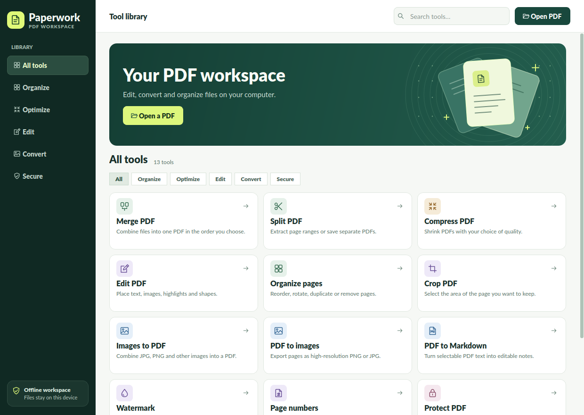
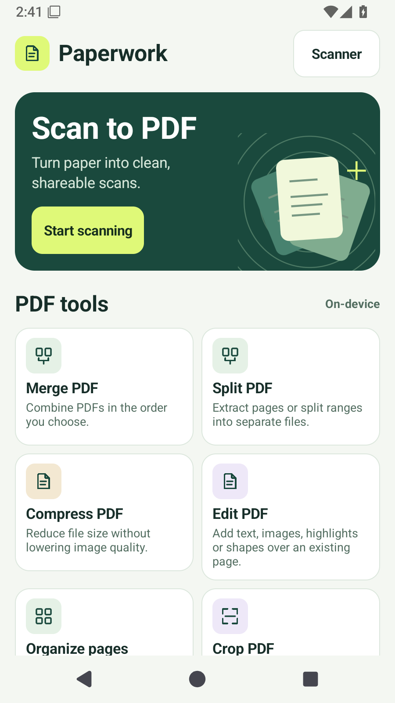

# Paperwork

Paperwork is an offline PDF editor for Ubuntu and Android. The Android app also turns photos into clean, multi-page document scans.

## Download

**[Download Paperwork for Ubuntu or Android](https://github.com/ishafayetul/paperwork-pdf/releases/latest)**

The releases page has both installers, SHA-256 checksums, and the matching source. See the [installation guide](docs/install.md) for setup and verification.

| Platform | Installer | Supported configuration |
| --- | --- | --- |
| Android | Signed `.apk` | Android 9 and later on ARM or x86 |
| Ubuntu | `.deb` | Ubuntu 24.04 on x86-64 |

## What you can do

- Merge PDFs, extract page ranges, split into separate PDFs, and compress files.
- Reorder, rotate, duplicate, remove, or crop pages. Add text, images, highlights, and rectangles.
- Convert images to PDF, render pages as PNG or JPEG, or export selectable text to Markdown.
- Add watermarks and page numbers, protect a PDF with AES-256 encryption, or unlock it with its known password.
- On Android, capture or import document photos, adjust detected corners, correct perspective, and apply Document, Grayscale, or Black & White effects. Rearrange pages and export them together.

| Ubuntu tool library | Android tool library |
| :---: | :---: |
|  |  |

## Guides

- [Install, verify, and update Paperwork](docs/install.md)
- [Scan documents on Android](android/README.md)
- [Build and test both apps](docs/build.md)
- [Security and reporting](SECURITY.md)
- [License and corresponding source](THIRD_PARTY_NOTICES.md)

Paperwork processes documents locally. Crop changes the visible page bounds and leaves content underneath. Editing places annotations or overlays over existing content. Markdown export uses selectable text and needs OCR first for scans. Rebuilding a PDF can invalidate existing digital signatures.

Paperwork is licensed under the [GNU Affero General Public License v3.0](LICENSE).
